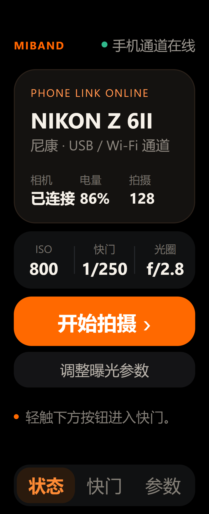
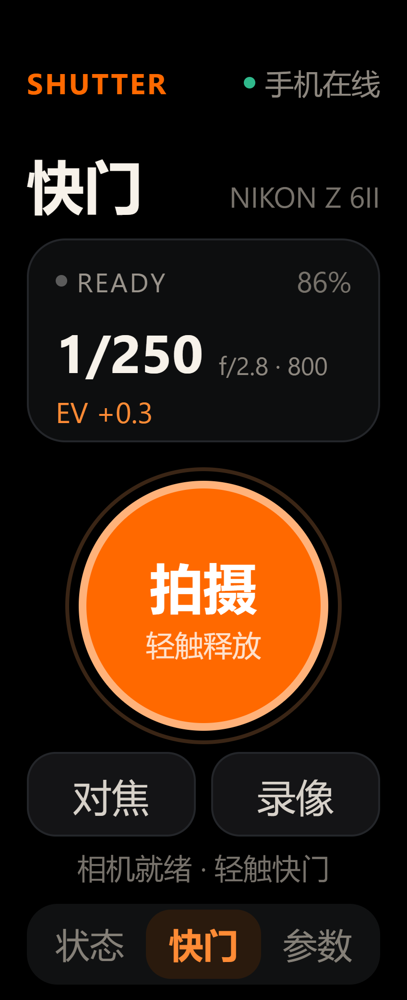
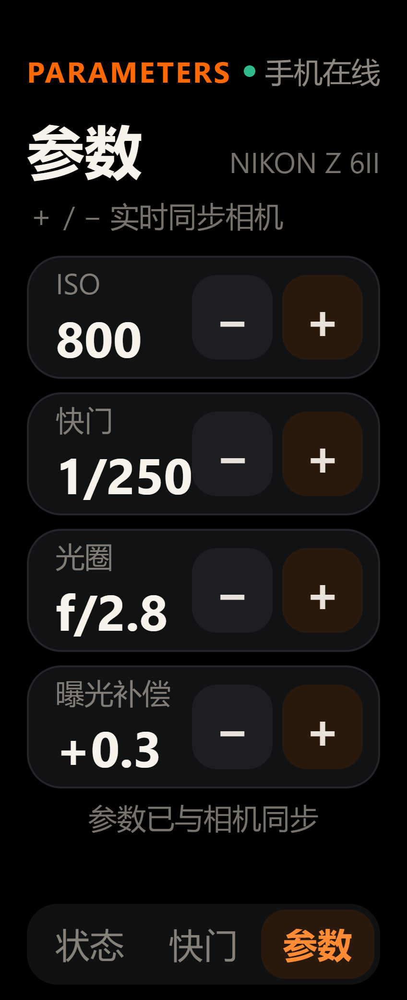

# 米环相机 · 小米手环 10 端

Vela JS 应用，运行在 **Xiaomi Smart Band 10**（1.725 英寸胶囊屏，212 × 520，PPI 326，DPR 2.0）上。它通过小米穿戴官方 `@system.interconnect` 与手机端「米环相机」通信，不直接连接相机，因此不额外消耗手环 Wi-Fi（手环本身无 Wi-Fi）。

工程目录按 AIoT IDE 标准结构组织，可直接用 AIoT IDE 打开、调试和打包；命令行使用官方 `aiot-toolkit 2.0.5` 构建。

## 页面

| 页面 | 路由 | 作用 |
|---|---|---|
| 状态 | `pages/index` | 手环/相机在线状态、相机型号、电量、张数、曝光摘要，进入快门/参数 |
| 快门 | `pages/shutter` | 独立大快门键、自动对焦、录像开关、状态反馈 |
| 参数 | `pages/params` | ISO / 快门 / 光圈 / 曝光补偿，＋/− 调整并实时同步 |

快门与参数拆成两个页面，避免小屏上误触。底部固定三段导航，始终可切换。

## 显示与可读性

- 设计基准宽度：`designWidth: 212`，即样式中的 `1px` 对应 212 × 520 屏幕的 1 个物理像素。
- 字号（像素）：主标题 30，相机型号 15，参数值 26，参数标签 15，主按钮 20–28，状态说明 14–16，底部导航 18。没有低于 12px 的功能文字，主操作均在 20px 以上。
- 触控目标：快门 130 × 130，参数步进 42 × 44，底部 tab 约 60 × 36，主按钮至少 50 高。
- 采用 Vela/HyperOS 的深色 AMOLED 底色、暖橙强调色、圆角卡片、红色录像状态、绿色在线点。
- 布局使用 Vela 原生 Flex（div 默认 flex），全部为 212 × 520 固定安全构图，不依赖浏览器能力。

## 设计预览

以下图片由页面真实样式离线渲染，用于检查 212 × 520 构图与字号（非真机截图）。

| 状态 | 快门 | 参数 |
|---|---|---|
|  |  |  |

## 目录

```
miband/
├── src/
│   ├── manifest.json          # package / 路由 / designWidth / interconnect 权限
│   ├── app.ux                 # 应用生命周期
│   ├── common/icon.png        # 192+ 图标
│   └── pages/
│       ├── index/index.ux     # 状态
│       ├── shutter/shutter.ux # 快门
│       └── params/params.ux   # 参数
├── sign/debug/                # 与 APK 相同的调试签名
├── sign/release/              # 与 APK 相同的发布签名
├── package.json               # aiot-toolkit
├── dist/                      # 打包产物
└── README.md
```

## 构建

```powershell
cd "C:\Users\Admin\Desktop\deepseek工作区\米环相机控制\miband"
npm install
npm run build      # 开发包 -> dist/com.miband.camremote.debug.1.0.1.rpk
npm run release    # 发布包 -> dist/com.miband.camremote.release.1.0.1.rpk
```

当前环境已经安装：

- Node.js 24
- `aiot-toolkit` 2.0.5（项目 `node_modules`）
- AIoT IDE 工程格式兼容

### 在 AIoT IDE 中

1. 打开 AIoT IDE，选择 `File → Open`，打开本目录。
2. IDE 将识别为 Vela JS 手表工程；选择「Watch」模拟器可预览。
3. 依赖安装后点击顶部「Package」生成 RPK。
4. 真机安装时，使用与手机 APK 相同的包名和签名（本工程已经配置好 `sign/debug` 与 `sign/release`）。
5. 在小米运动健康中连接手环，安装 RPK，并在手机端打开「米环相机」，允许手环连接授权。

> `interconnect` 的前提：RPK 的 `package` 与 Android 的 `applicationId` 相同，且证书一致。两者均为 `com.miband.camremote`。

## 通信协议

手机 → 手环（JSON 字符串）：

```json
{
  "v": 1,
  "type": "state",
  "connected": true,
  "brand": "尼康",
  "model": "Z 6II",
  "battery": 86,
  "shots": 128,
  "busy": false,
  "recording": false,
  "count": 12,
  "iso": "800",
  "shutter": "1/250",
  "aperture": "f/2.8",
  "ev": "+0.3",
  "band": true,
  "message": "已连接 · Z 6II"
}
```

手环 → 手机（`connect.send({ data: payload })`）：

| cmd | 参数 | 行为 |
|---|---|---|
| `status` | – | 返回最新状态 |
| `capture` | – | 触发快门（手机端自动对焦后释放） |
| `focus` | – | 自动对焦 |
| `record` | `value: true/false` | 开始/停止录像（按相机支持） |
| `live` | `value: true/false` | 开关实时取景（手机端显示，手环只显示状态） |
| `adjust` | `key: iso/shutter/aperture/ev`, `dir: 1/-1` | 按相机选项步进 |
| `set` | `key`, `value` | 直接设置某个参数值 |
| `options` | – | 返回主要参数的可选值列表 |

手环每 2 秒请求一次 `status`，拍摄/参数动作后手机会主动推送状态。

## 设计说明

- **状态页**：相机型号、品牌/通道、曝光三要素和最近拍摄数量一屏呈现；无相机时明确提示在手机端连接。
- **快门页**：取景器氛围区只显示关键曝光信息，中央 130px 橙色快门键是最强视觉焦点；对焦/录像并列在下方，避免小按钮。
- **参数页**：四项曝光参数独立卡片；左侧大字数值，右侧 42×44 的 −/＋，手指点击范围充足。
- **色彩**：`#000000` AMOLED 背景、`#141210`/`#111213` 卡片、`#FF6900` 品牌橙、`#30B98C` 在线绿、`#F7F2EA` 主文字、`#77726B` 次文字。
- **字体**：Vela 系统字体，字号全部使用 `px`（designWidth 212，不缩放）。字号经过 212 × 520 离线渲染检查，最小功能文字 12px 仅用于装饰性英文标签，中文功能文字不小于 14px。

## 1.0.1 启动与授权修复

- 移除了 Vela 运行时无法稳定处理的页面 `private` 状态块；这是启动卡在黑屏的实际原因。
- 应用启动时**不加载** `@system.interconnect`，页面先渲染；首页点“连接手机”才加载模块。这样即使手环系统没有该能力，也不会卡在启动页。
- 请求失败或模块缺失时，页面显示“通信接口不可用”，仍可退出。
- 手机端改为从可见 Activity 请求手环权限，手机上出现“请求手环授权”按钮。
- 正确步骤：
  1. 手机安装 1.0.1 APK，打开 App；
  2. 手环**先卸载旧版**，再安装 1.0.1 RPK；
  3. 手环打开「米环相机」，点“连接手机”；
  4. 手机「连接」页显示手环节点后，点“请求手环授权”；
  5. 在小米运动健康弹出的授权页允许 `DEVICE_MANAGER` / `NOTIFY`。

> 如果手环首页能正常显示，但点“连接手机”后卡住，说明当前手环固件没有注册 `system.interconnect` 能力（部分 Vela 模拟器/系统镜像确实不注册）。这需要设备固件支持；应用本身不会再卡在启动页。

## 已知限制

- 手环不显示实时取景视频，只显示状态和曝光参数（BLE 消息通道不适合传 JPEG 流）。
- 手环完全依赖手机端和相机连接；手机端未连接相机时只能查看连接状态。
- 录像、实时取景、参数可选项取决于相机型号；手机端会隐藏不支持的项目。
- 真机安装/授权需要小米运动健康和对应的小米穿戴 SDK 版本；模拟器无法验证 `interconnect` 的真实链路。
- 页面采用 212 × 520 构图，其他 Vela 手表会按 designWidth 等比缩放，但本版本只针对小米手环 10 优化。


